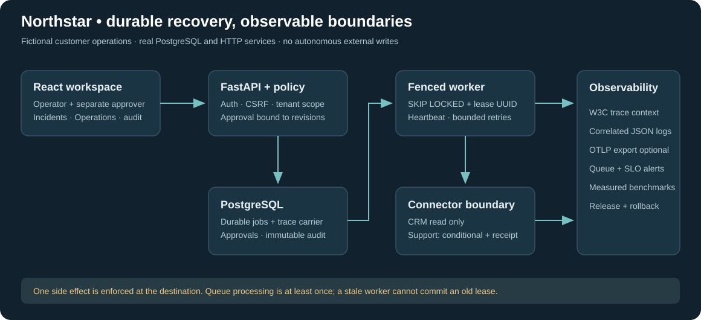
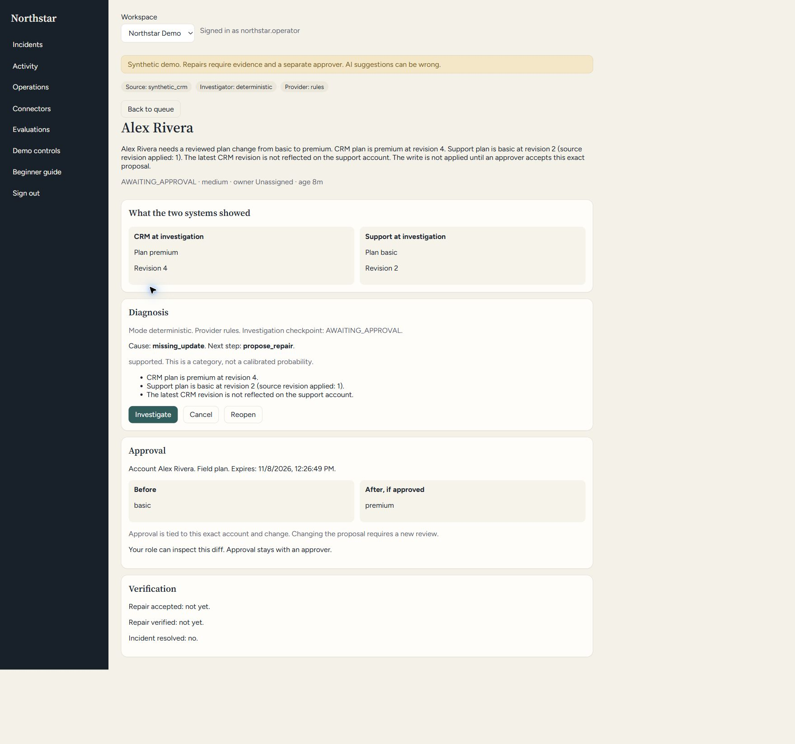
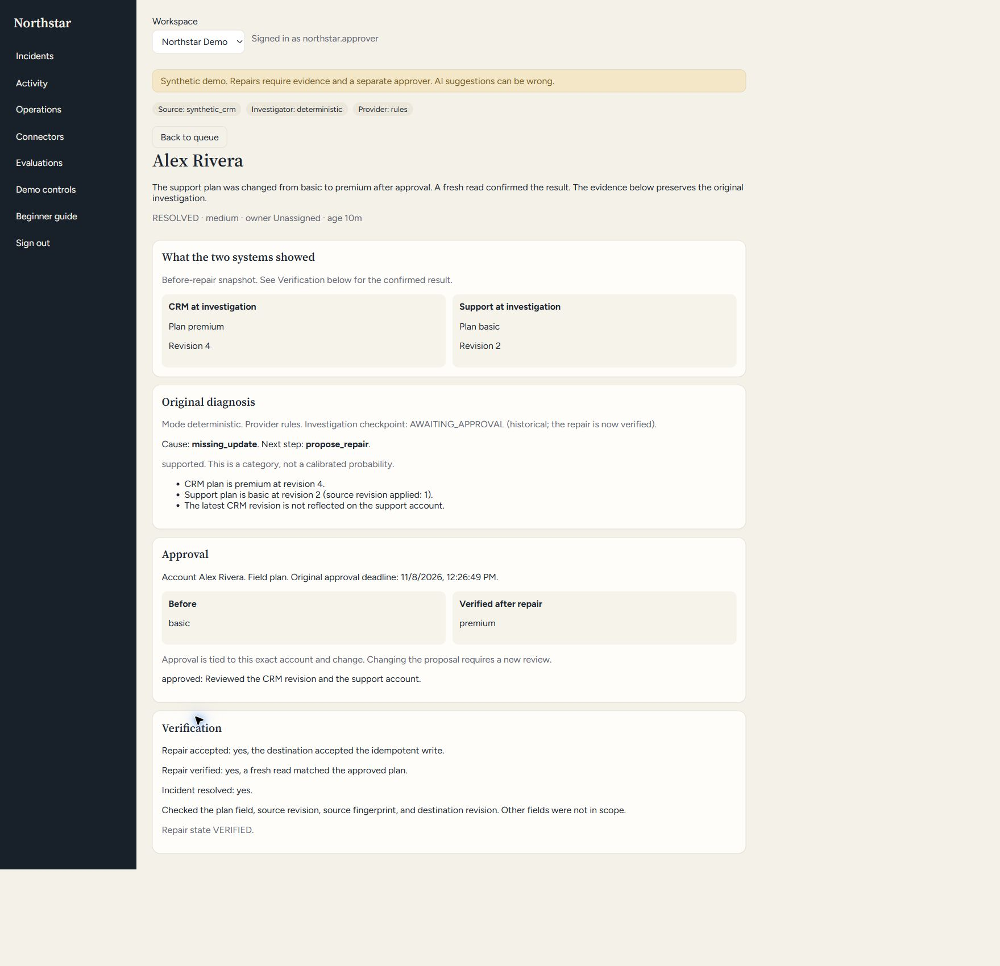
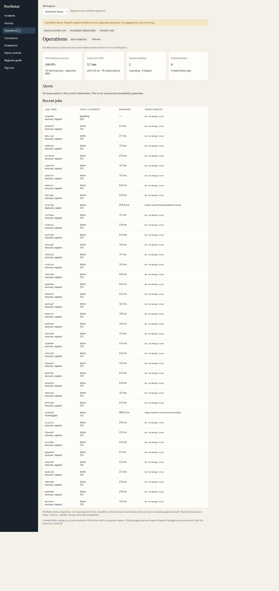
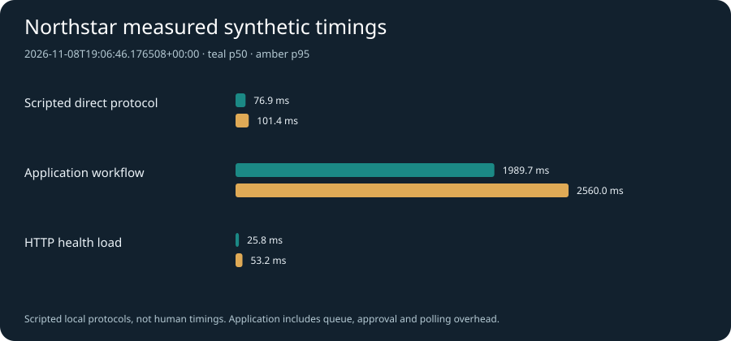

# Northstar Cloud Reliability

**A customer operations workflow that can stop, restart, retain approval state, and explain what happened.**

Northstar investigates a fictional customer's plan mismatch between a CRM and a support system. An operator reviews evidence, an approver authorizes one exact change, and a durable worker applies a conditional update to the local support simulator. The Operations view exposes the queue, lease recovery, trace IDs and measured demo objectives.

This repository extends an existing Northstar Recovery application. It is an AI-assisted portfolio project, not a deployed customer system. The default demo uses no paid AI API and makes no external CRM writes. A cloud deployment recipe is included but **cloud resources have not been provisioned, deployed or billed**.



## Actual application walkthrough

The images below were captured from the running native synthetic application, not generated mockups. The operator sees a proposal but cannot approve; a separate approver authorizes it; the worker resolves it with a fresh destination verification. Operations exposes observed jobs and trace IDs. These are portfolio demo records, not customer production evidence.







## What this extension demonstrates

| Boundary | Implemented behavior | Verification |
|---|---|---|
| Durable work | PostgreSQL queue, persisted retries and approvals | Actual worker-process termination and restart tests |
| Stale workers | Fresh UUID per claim; expiry-aware atomic renewal/completion; pre-dispatch guard | Stale token cannot renew/finish, including owner-ID reuse; lease loss starts no new write |
| Duplicate effects | Immutable destination receipt plus expected revision | Lost response and crash after commit resolve to one verified write |
| Approval | Proposal hash, revisions, expiry, roles and cancellation; production prevents self-approval | Safety/regression tests and distinct-account guard test |
| Observability | W3C context through request, durable job, worker and HTTP connector; JSON logs | Actual worker log/span correlation; JSONL and optional OTLP export |
| Operations | Workspace-scoped queue, terminal success, p50/p95, dead-letter and stale-lease alerts | Authorization, tenant-isolation and SLO tests |
| Replay | Administrator reason, audit, retained attempts and bounded extra budget | Repeat replay rejected; repair dispatch budget unchanged |
| Delivery | Locked dependencies, CI, release integrity, rollback and cloud VM recipe | Local tests/build plus actual GitHub CI status; cloud activation separate |

The starting application already had FastAPI, PostgreSQL, LangGraph checkpointing, React, human approvals, receipts, basic recovery, heartbeat renewal, a read-only HubSpot adapter and 70 tests. These are inherited, not new accomplishments. The new work strengthens fencing and operational evidence. It does **not** implement Temporal or establish autonomous AI reliability, production scale, customer adoption or business savings. See [provenance](docs/PROVENANCE.md).

## Start locally

Requirements: Python **3.12**, Node 22 and available loopback ports. Docker is optional. No HubSpot signup or model download is needed.

### Windows PowerShell

```powershell
python -m venv .venv
.\.venv\Scripts\python.exe -m pip install -r requirements.lock
Push-Location apps\web
npm.cmd ci
npm.cmd run build
Pop-Location
.\.venv\Scripts\python.exe -B scripts\native.py serve
```

### macOS / Linux

```bash
python3.12 -m venv .venv
. .venv/bin/activate
python -m pip install -r requirements.lock
(cd apps/web && npm ci && npm run build)
python -B scripts/native.py serve
```

Open **http://127.0.0.1:28601**. The API serves the built React interface on the same origin. Generated fictional credentials are in ignored `var/local-credentials.txt`. Start as `northstar.operator`, then sign in as `northstar.approver` for an independent approval. The inherited `northstar.combined` account is an explicitly labeled **local demo compromise**. Cloud seeding disables it, and production approval requires a different authenticated user account from the investigator, including for administrators.

Press **Ctrl+C** in the controller terminal to stop only its child API, CRM, support and worker services. The isolated PostgreSQL cluster remains under ignored `var/pgdata` for reuse. The runner refuses occupied service ports and does not stop unrelated processes.

| Component | Native port |
|---|---:|
| API and web UI |28601|
| Synthetic CRM |28611|
| Synthetic support |28621|
| This project's PostgreSQL |55438|
| Integration-test CRM / support |28711 /28721|

These avoid the old practice application’s ports 8100 and 55432. Override `NORTHSTAR_API_PORT`, `NORTHSTAR_CRM_PORT`, `NORTHSTAR_SUPPORT_PORT` and `NORTHSTAR_PG_PORT` if needed. Do not point this project at a real CRM or shared production database.

## Five-minute walkthrough

1. Sign in as the operator, choose **Northstar Demo**, and open the plan mismatch.
2. Start the investigation. Default deterministic mode reads both fictional systems and proposes Basic → Premium in support. An LLM is not necessary for this reliability proof.
3. Review evidence, before/after values, revisions and expiry. This is not an executable free-form model suggestion.
4. Sign in separately as the approver and approve that exact proposal. Observe **RESOLVED**, verified destination data and one write.
5. Open **Operations**. Follow the trace ID through `var/traces-*.jsonl` and `var/logs/native/*/recovery.log`. Check sample counts before interpreting the demo objective.

Demo resets affect shared synthetic service records. Do not reset while another person practices or benchmarks. Workspaces are authorization boundaries, not physically separate destination databases.

## Tests and failure proofs

```powershell
.\.venv\Scripts\python.exe -B scripts\native.py test
```

Tests prepare this project's PostgreSQL cluster and use separate test databases/HTTP ports. They do not reset the original practice app. SQLite is not used to claim PostgreSQL locking behavior.

- Terminate an actual owned child after a durable claim; recover after lease expiry with a fresh UUID.
- Reject stale completion/renewal after reassignment, including reuse of the same owner string.
- Lose a lease before repair entry and after intent commit but before destination dispatch.
- Persist an incoming trace ID through a queued job and a completed worker log.
- Enforce workspace scope, payload-free observations and administrator-only audited replay.
- Retain inherited crash tests after intent, destination commit, SUCCEEDED and RECONCILING; verify no second side effect.

See [validation](docs/VALIDATION_2026-11-08.md) and `evidence/validation.json` for actual commands/results and unexecuted paths. Inherited FastAPI startup and LangGraph serializer deprecation warnings are recorded rather than hidden.

## Reproduce measured timings

Use a **dedicated** synthetic demo with the native worker running. This explicitly resets it between cases:

```powershell
.\.venv\Scripts\python.exe -B scripts\benchmark.py --allow-reset --cases 8 --requests 100 --concurrency 4
```

The script refuses non-loopback URLs and external/non-synthetic CRM workspaces. It executes two real localhost HTTP protocols:

1. **Scripted direct protocol:** read CRM, read support, compare, conditional write, verify.
2. **Application workflow:** reconcile, durable investigation, separately authenticated **scripted** approval, execute, poll and verify exactly one write.

It also measures concurrent HTTP readiness requests. JSON and SVG go to `evidence/benchmark.json` and `.svg`. Connection creation, queue polling and database work are included as documented in the report. The direct protocol omits governance overhead, so lower latency does not establish a better workflow. Neither protocol measures human think time, labor savings or customer ROI. No assumed seconds are presented as measurements.



Actual November 8 local run: eight automated cases each verified one destination write;100 HTTP readiness requests at concurrency4 returned zero failures.

| Timed protocol | Samples | p50 | p95 |
|---|---:|---:|---:|
| Scripted direct protocol | 8 | 76.9 ms | 101.4 ms |
| Application workflow | 8 | 1989.7 ms | 2560.0 ms |
| HTTP readiness load | 100 | 25.8 ms | 53.2 ms |

These measurements include local machine contention and are not a production capacity claim. Trace evidence joins18 trace IDs across API, worker, CRM and support; [sanitized example](evidence/trace-correlation.json) includes matching log counts without bodies or credentials.

Cloud bill, local electricity cost and production throughput remain unmeasured. Default paid model API calls: zero.

## Operations and trace queries

| Endpoint | Access and purpose |
|---|---|
| `GET /health/live` | Process and build marker |
| `GET /health/ready` | Database readiness, not worker certification |
| `GET /api/v1/operations` | Authenticated workspace queue/SLO observations |
| `POST /api/v1/operations/jobs/{id}/replay` | Administrator, CSRF, reason; only a dead job in that workspace |
| `GET /api/v1/activity` | Authorized workspace audit history |

The demo objective is terminal job success >=99% and last successful execution p95 <=5000ms, with at least ten terminal jobs and ten duration samples. Otherwise the UI says **insufficient data**. Maintenance sweeps are excluded. This is a portfolio diagnostic, not a production SLA. Execution duration excludes approval waiting. Readiness load is a separate benchmark. Read the [runbook](docs/RELIABILITY_RUNBOOK.md) before replaying a job.

Set `OTEL_EXPORTER_OTLP_ENDPOINT` only for an authorized collector. Without one, local traces and structured logs remain functional. Attributes exclude credentials, bodies and notes. Dashboard alerts do not imply an externally delivered page; no hosted observability account or notification channel is configured.

## Containers, cloud delivery and rollback

On a fresh Docker machine the inherited development composition is available:

```bash
docker compose up --build
```

It uses synthetic defaults and development host ports, which may conflict with the older practice app. Do not expose this development composition to the Internet.

The separate [`deploy/README.md`](deploy/README.md) describes the cloud VM composition: HTTPS proxy, private database/connectors, generated secrets, nonroot application image and explicit activation steps. Production startup rejects insecure cookies, default short tokens, non-HTTPS origins and implicit local database URLs. No provider, VM, domain, spending limit or deployment has been activated here.

Use `python scripts/release.py --help` for integrity-checked snapshots, verification, activation and rollback. Keep the previous known-good application release. An app rollback is not a destructive database downgrade; the reliability migration adds backward-compatible metadata. The deployment tooling supports health-gated Docker rollback, but local Docker/cloud execution must not be inferred from filesystem tests.

## Repository guide

```text
apps/api/recovery_api/      Policy, approvals, durable queue, operations and traces
apps/worker/               Heartbeat, fencing and repair recovery
apps/web/                  React interface and Operations view
services/                  Isolated CRM and support simulators
packages/recovery_core/    Domain, hashing, redaction and policy helpers
migrations/                Original schema plus reliability metadata
tests/                     Inherited and extension failure/regression tests
scripts/native.py          Isolated portable startup and testing
scripts/benchmark.py       Actual HTTP synthetic timing comparison
scripts/release.py         Integrity, activation and rollback tooling
deploy/                    Unactivated cloud recipe and bootstrap helpers
evidence/                  Sanitized measured reports and charts
docs/                      Architecture, provenance, validation and runbooks
```

Historical review documents can mention former ports or machine-specific setup. This README and `scripts/native.py` are the current supported path. `docs/INHERITED_SOURCE_MANIFEST.json` records the 125 starting file hashes and makes the extension auditable.

## Limits

- Queue execution is at least once. An already in-flight request cannot be recalled; receipts and conditional writes enforce the tested destination effect boundary.
- This single-plan fictional workflow is not a general workflow platform or a validated production agent.
- Default investigation is deterministic. Optional inherited model behavior is not required or claimed as model superiority.
- Real HubSpot credentials/account records are excluded; inherited HubSpot access remains read only.
- Credentials, runtime data, logs, caches and environments stay outside Git and Docker contexts.
- Cloud operation, practitioner validation, real adoption, production SLOs and business savings are not established.

Project owner: **Vinay Vikkranth Subramanian**. Implementation/review are AI-assisted. [Provenance](docs/PROVENANCE.md) records source/dependency rights; no blanket relicensing of inherited work is implied.
